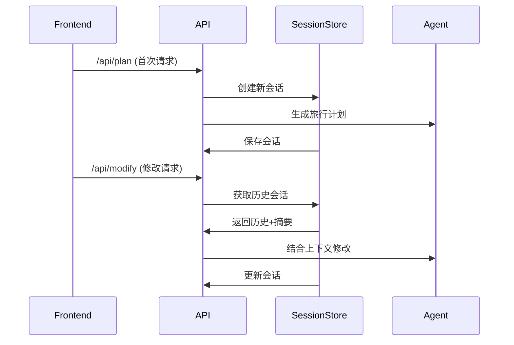

# 智能旅行规划助手 - 项目架构文档

## 项目概述

这是一个基于多智能体协作的智能旅行规划系统，集成了高德地图、天气查询、酒店推荐等外部服务，支持多轮对话交互，并具备完善的性能监控和优化能力。

## 技术栈

- **后端框架**: FastAPI + Python 3.8+
- **AI模型**: OpenAI GPT系列兼容
- **数据库**: SQLite (会话存储)
- **外部服务**: 高德地图API、天气API、Unsplash图片API
- **前端**: Vue.js (待部署)
- **架构模式**: 多智能体协作、ReAct模式、异步并发

## 核心功能架构

### 一、多轮记忆系统

#### 1.1 会话存储架构
```
SessionStore (SQLite)
├── sessions 表
│   ├── session_id (主键)
│   ├── user_request (JSON)
│   ├── current_plan (JSON)
│   ├── messages (JSON数组)
│   ├── summary (文本摘要)
│   └── updated_at (时间戳)
└── 数据持久化策略
    ├── 自动事务提交
    ├── JSON序列化存储
    ├── 异常处理机制
```

#### 1.2 历史管理机制
- **完整历史存储**: 最多保留6条完整对话
- **历史压缩**: 每10条消息自动压缩为摘要
- **会话隔离**: 每个会话独立管理，避免数据污染

#### 1.3 多轮交互流程


### 二、响应延迟优化

#### 2.1 并行处理架构
```python
# 串行处理 (旧版本)
weather = await weather_agent.run(...)
attractions = await attraction_agent.run(...)
hotels = await hotel_agent.run(...)
# 总耗时 = 3 × 单个耗时

# 并行处理 (新版本)
weather_task = asyncio.create_task(weather_agent.run(...))
attractions_task = asyncio.create_task(attraction_agent.run(...))
hotels_task = asyncio.create_task(hotel_agent.run(...))
# 总耗时 ≈ max(单个耗时)
```

#### 2.2 性能监控体系
```
PerformanceMiddleware
├── 请求拦截 (全局)
├── 计时管理
│   ├── 开始计时
│   └── 结束计时
├── 指标收集
│   ├── LLM调用统计
│   ├── 外部API统计
│   └── Token消耗统计
└── 报告生成
    ├── 实时统计
    └── 导出功能
```

#### 2.3 关键性能指标
1. **响应时间**
   - 整体响应延迟
   - 各阶段耗时分解
   - 响应时间分布

2. **Token消耗**
   - 输入/输出Token统计
   - 成本估算（$0.001/1K输入, $0.002/1K输出）
   - Token使用趋势

3. **服务质量**
   - API调用成功率
   - 外部服务响应时间
   - 错误率统计

### 三、多智能体协作系统

#### 3.1 Agent架构
```
TripMaster (总控)
├── weather_expert (天气专家)
│   └── keywords: ["weather"]
├── attraction_agent (景点专家)
│   └── keywords: ["text_search", "get_poi_photo"]
├── hotel_expert (酒店专家)
│   └── keywords: ["hotel_search", "poi_detail", "search_nearby"]
└── trip_planner (规划专家)
    └── keywords: ["search_nearby"]
```

#### 3.2 ReAct执行模式
```
1. 思考 (Reason)
   - 理解用户需求
   - 确定调用策略

2. 行动 (Act)
   - 选择合适工具
   - 执行工具调用

3. 观察 (Observe)
   - 解析工具结果
   - 反馈给LLM
   - 循环直到结果满意
```

#### 3.3 工具管理
```python
ToolRegistry (工具注册中心)
├── 按需注册
├── 关键词过滤
├── 工具说明管理
└── 异步工具调用
```

### 四、数据模型设计

#### 4.1 核心实体关系
```
TripRequest (用户请求)
    ↓
TripPlan (旅行计划)
    ├── DayPlan (每日计划)
    │   ├── Attraction (景点)
    │   ├── Meal (餐饮)
    │   └── Hotel (酒店)
    └── WeatherInfo (天气)
        ↓
Session (会话记录)
    └── ConversationMessage (消息历史)
```

#### 4.2 数据一致性保证
- Pydantic模型验证
- JSON Schema约束
- 类型安全保证
- 异常容错处理

## 文件结构

```
D:\AIproject\MCP\
├── app/                          # 主应用目录
│   ├── __init__.py
│   ├── api.py                    # API路由和业务逻辑
│   ├── models/                   # 数据模型
│   │   ├── __init__.py
│   │   └── schemas.py           # Pydantic模型定义
│   ├── services/                 # 外部服务集成
│   │   ├── __init__.py
│   │   ├── amap_mcp_service.py  # 高德地图服务
│   │   ├── unsplash_mcp_service.py # Unsplash图片服务
│   │   └── session_store.py     # 会话存储服务
│   ├── tools/                    # 工具管理
│   │   ├── __init__.py
│   │   └── registry.py          # 工具注册中心
│   ├── SimpleAgent.py           # Agent基类
│   ├── system_prompt.py         # 专家角色提示词
│   ├── trip_planner.py         # 旅行规划主逻辑
│   ├── parallel_planner.py     # 并行规划器
│   ├── performance_middleware.py # 性能监控中间件
│   ├── metrics.py              # 指标收集
│   ├── llm_client.py          # LLM客户端
│   ├── amap_mcp.py           # MCP协议封装
│   ├── benchmark.py           # 性能测试
│   └── test_session.py        # 会话测试
├── frontend/                    # 前端项目
│   ├── src/
│   │   ├── App.vue
│   │   └── components/
│   │       └── TravelResult.vue
│   └── package.json
├── services/                    # MCP服务进程
│   ├── amap_mcp_service.py
│   └── unsplash_mcp_service.py
├── run_benchmark.py            # 运行性能测试
├── MULTI_TURN_FEATURE.md       # 多轮功能说明
├── PERFORMANCE_OPTIMIZATION_REPORT.md # 性能优化报告
├── benchmark_results_*.json   # 测试结果
├── sessions.db                # SQLite数据库
├── .env                       # 环境变量
└── README.md                  # 项目说明
```

## 环境配置

### 1. 必需的环境变量
```bash
# LLM服务配置
LLM_MODEL_ID=gpt-3.5-turbo-0125
LLM_API_KEY=your_openai_api_key
LLM_BASE_URL=https://api.openai.com/v1

# 高德地图API
AMAP_API_KEY=your_amap_api_key

# Unsplash图片API
UNSPLASH_ACCESS_KEY=your_unsplash_key
```

### 2. 安装依赖
```bash
pip install fastapi uvicorn pydantic python-dotenv mcp openai sqlite3 requests
cd frontend
npm install
```

### 3. 启动服务
```bash
# 后端服务
python -m uvicorn app.api:app --reload --host 0.0.0.0 --port 8000

# 前端服务
cd frontend
npm run dev
```

## 部署建议

### 1. 生产环境优化
- 使用Redis替代SQLite进行会话存储
- 添加API限流和安全验证
- 使用Docker容器化部署
- 配置日志收集和监控

### 2. 性能优化
- 实现结果缓存机制
- 添加请求队列处理
- 使用CDN加速静态资源
- 配置负载均衡

### 3. 扩展性考虑
- 支持更多外部API集成
- 添加用户认证系统
- 实现插件化工具扩展
- 支持多语言旅行规划

## 注意事项

1. **敏感信息保护**
   - API密钥通过环境变量管理
   - 不要提交.env文件到Git
   - 使用HTTPS传输

2. **数据库管理**
   - 定期备份sessions.db
   - 实现数据清理策略
   - 监控存储空间使用

3. **API限制**
   - 注意外部API的调用频率限制
   - 实现降级和重试机制
   - 监控API使用量

4. **性能监控**
   - 定期检查性能指标
   - 分析瓶颈并进行优化
   - 保持系统稳定性

## 更新日志

### v1.0.0
- 实现基础旅行规划功能
- 集成高德地图API
- 支持多轮对话交互
- 实现性能监控系统
- 完成并行处理优化

---
*本文档最后更新时间：2026-04-03*