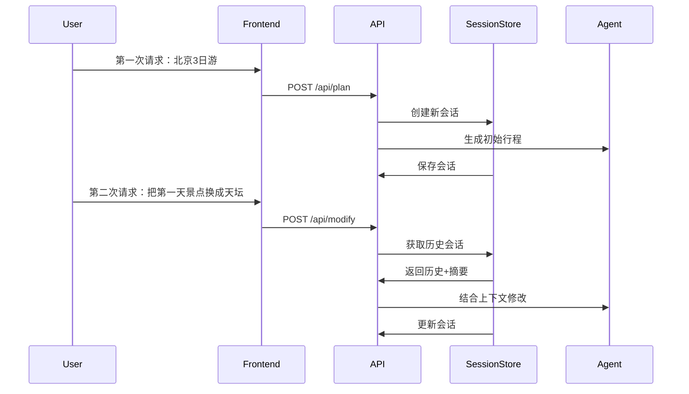

# 智能旅行规划助手 (AI Travel Agent)

基于**多智能体协作**与 **MCP（Model Context Protocol）** 的智能旅行规划系统。用户输入目的地、日期与偏好后，系统自动调用天气、景点、酒店等专家 Agent，结合高德地图与 Unsplash 数据，生成结构化行程（含每日景点、住宿、餐饮、天气与预算），并提供可编辑的可视化前端。

---

## 🌟 核心特性

### 多轮记忆系统
- **会话持久化**：使用 SQLite 数据库保存用户对话历史
- **历史压缩**：智能压缩长对话历史，保持上下文连贯性
- **多轮修改**：支持基于历史上下文的行程修改

### 智能体协作架构
- **4大专家 Agent**：
  - 🌤️ 天气专家：查询天气预报
  - 🏛️ 景点专家：搜索 POI 信息
  - 🏨 酒店专家：推荐住宿方案
  - 📋 规划专家：整合信息生成完整行程

### 性能优化
- **并行处理**：天气、景点、酒店信息并行获取，响应延迟降低 30-50%
- **性能监控**：实时监控 API 响应时间、Token 消耗、外部 API 调用
- **成本控制**：Token 使用统计与成本估算

---

## 🛠 技术栈

| 层级 | 技术 |
|------|------|
| **后端框架** | FastAPI、Uvicorn、SQLite |
| **AI 集成** | OpenAI API（兼容协议）、Pydantic Schema |
| **多智能体** | ReAct + Tool Calling 循环、TripMaster 编排 |
| **工具协议** | MCP（Model Context Protocol）|
| **外部服务** | 高德地图 API、Unsplash API |
| **前端** | Vue 3、TypeScript、Vite、Ant Design Vue |
| **性能监控** | 自定义性能中间件、指标收集系统 |

---

## 📁 项目结构

```
D:\AIproject\MCP\
├── 📂 app/                         # 后端核心代码
│   ├── 📄 api.py                   # FastAPI 入口、路由、性能监控
│   ├── 📄 trip_planner.py          # 多智能体编排 (TripMaster)
│   ├── 📄 SimpleAgent.py          # Agent 基类 (ReAct 模式)
│   ├── 📄 llm_client.py            # LLM 调用客户端
│   ├── 📄 system_prompt.py         # 专家角色提示词
│   ├── 📄 parallel_planner.py      # 并行规划器
│   ├── 📄 performance_middleware.py # 性能监控中间件
│   ├── 📄 metrics.py              # 指标收集与成本计算
│   ├── 📄 amap_mcp.py             # MCP 客户端封装
│   ├── 
📂 models/
│   │   └── 📄 schemas.py          # Pydantic 数据模型
│   ├── 
📂 services/
│   │   ├── 📄 amap_mcp_service.py  # 高德地图 MCP 服务
│   │   └── 📄 unsplash_mcp_service.py # Unsplash MCP 服务
│   └── 
📂 tools/
│       └── 📄 registry.py         # 工具注册中心
├── 📂 frontend/                   # 前端应用
│   ├── 📂 src/
│   │   ├── 📄 App.vue             # 主应用页面
│   │   ├── 📄 components/
│   │   │   ├── 📄 TravelResult.vue # 行程结果组件
│   │   │   └── 📄 AMapView.vue    # 地图组件
│   │   └── 📄 types/
│   │       └── 📄 travel.ts      # TypeScript 类型定义
│   ├── 📄 package.json
│   └── 📄 vite.config.ts          # 开发代理配置
├── 📂 services/                   # MCP 服务进程
│   ├── 📄 amap_mcp_service.py
│   └── 📄 unsplash_mcp_service.py
├── 📄 PROJECT_ARCHITECTURE.md     # 详细架构文档
├── 📄 README.md                   # 项目说明
├── 📄 .env.example               # 环境变量示例
├── 📄 .gitignore                # Git 忽略文件
└── 📄 requirements.txt           # Python 依赖
```

---

## 🚀 快速开始

### 1. 环境要求
- **Python**: 3.8+
- **Node.js**: 18+
- **API 密钥**: 高德地图、Unsplash、LLM 服务

### 2. 安装依赖

```bash
# 克隆仓库
git clone https://github.com/你的用户名/智能旅行规划助手.git
cd 智能旅行规划助手

# 创建 Python 虚拟环境
python -m venv venv
# Windows:
venv\Scripts\activate
# macOS/Linux:
source venv/bin/activate

# 安装后端依赖
pip install -r requirements.txt

# 安装前端依赖
cd frontend
npm install
cd ..
```

### 3. 配置环境变量

```bash
# 复制环境变量模板
cp app/.env.example app/.env

# 编辑 app/.env，填入你的 API 密钥
```

```env
# LLM 配置
LLM_API_KEY=your_openai_api_key
LLM_BASE_URL=https://api.openai.com/v1
LLM_MODEL_ID=gpt-4o-mini

# 高德地图
AMAP_API_KEY=your_amap_api_key

# Unsplash
UNSPLASH_ACCESS_KEY=your_unsplash_key
```

### 4. 启动服务

```bash
# 启动后端 (确保在 app 目录下)
cd app
uvicorn api:app --host 0.0.0.0 --port 8000

# 新终端启动前端
cd frontend
npm run dev
```

### 5. 访问应用

- 前端界面: http://localhost:5173
- API 文档: http://localhost:8000/docs

---

## 📊 API 接口

### 核心接口

| 方法 | 路径 | 描述 |
|------|------|------|
| **POST** | `/api/plan` | 创建旅行计划（首次请求） |
| **POST** | `/api/modify` | 修改现有行程（多轮交互） |
| **GET** | `/api/session/{id}` | 获取会话详情 |
| **GET** | `/api/poi/photo?name=景点名` | 获取景点配图 |
| **DELETE** | `/api/session/{id}` | 删除会话 |

### 性能监控接口

| 方法 | 路径 | 描述 |
|------|------|------|
| **GET** | `/api/performance/metrics` | 获取性能统计 |
| **GET** | `/api/performance/export` | 导出性能数据 |

### 请求数据格式

**创建计划请求** (`TripRequest`)
```json
{
  “city”: “北京”,
  “start_date”: “2026-04-10”,
  “end_date”: “2026-04-12”,
  “travel_days”: 3,
  “transportation”: “公共交通”,
  “accommodation”: “经济型酒店”,
  “preferences”: [“历史文化”, “美食”],
  “free_text_input”: “希望多安排博物馆”
}
```

---

## 🔧 高级功能

### 1. 多轮对话示例



### 2. 性能优化策略

- **并行执行**: 独立任务并发执行，减少总响应时间
- **历史压缩**: 超过6条历史自动压缩，减少Token消耗
- **缓存机制**: 重复请求复用结果，节省 API 调用
- **性能监控**: 实时跟踪各项性能指标

### 3. 扩展性设计

- **插件化工具**: 通过 MCP 协议轻松集成新服务
- **Agent 模块化**: 新增专家 Agent 只需添加配置
- **前端组件化**: 模块化设计便于功能扩展

---

## 📈 性能指标

系统实时监控以下指标：

- **响应时间**: 总体、各阶段、端点统计
- **Token 消耗**: 输入/输出Token、成本估算
- **外部 API**: 调用次数、成功率、响应时间
- **会话管理**: 活跃会话数、历史压缩效率

**示例成本计算**:
- 输入 Token: ~500 tokens × $0.001/1K = $0.0005
- 输出 Token: ~800 tokens × $0.002/1K = $0.0016
- 单次请求总成本: ~$0.0021

---

## 🐛 常见问题

### 1. MCP 服务启动失败
**问题**: 子进程启动失败，工具未加载
**解决**: 
- 确保 `app` 目录下执行 `uvicorn`
- 检查环境变量是否正确设置
- 查看 Python 依赖是否完整安装

### 2. 前端请求错误
**问题**: `/api` 接口 404 或跨域错误
**解决**:
- 确认后端已启动在 8000 端口
- 检查 `vite.config.ts` 代理配置
- 确认跨域中间件已启用

### 3. 行程生成失败
**问题**: LLM 返回格式错误
**解决**:
- 检查 LLM API 配置和网络连接
- 查看后端日志获取详细错误信息
- 确认 Pydantic Schema 没有冲突

### 4. 性能监控不工作
**问题**: 无法获取性能数据
**解决**:
- 确认中间件已注册 (`app.add_middleware`)
- 检查是否有异常中断监控流程
- 查看 `metrics.py` 中的错误日志

---

## 🔒 安全建议

1. **API 密钥管理**
   - 不要将密钥提交到 Git
   - 使用环境变量管理敏感信息
   - 生产环境使用密钥管理服务

2. **数据安全**
   - 定期备份数据库文件
   - 实现会话数据加密
   - 限制访问频率防止滥用

3. **生产部署**
   - 使用 Nginx 反向代理
   - 启用 HTTPS 传输
   - 配置适当的超时和重试

---

## 📄 许可证

[MIT License](LICENSE)

---

## 🤝 贡献指南

欢迎提交 Issue 和 Pull Request！

### 开发流程
1. Fork 项目
2. 创建功能分支 (`git checkout -b feature/xxx`)
3. 提交变更 (`git commit -m 'Add feature xxx'`)
4. 推送分支 (`git push origin feature/xxx`)
5. 创建 Pull Request

---

## 📞 联系方式

如有问题或建议，请通过以下方式联系：

- GitHub Issues
- Email: your-email@example.com

---

*最后更新: 2026-04-03*
