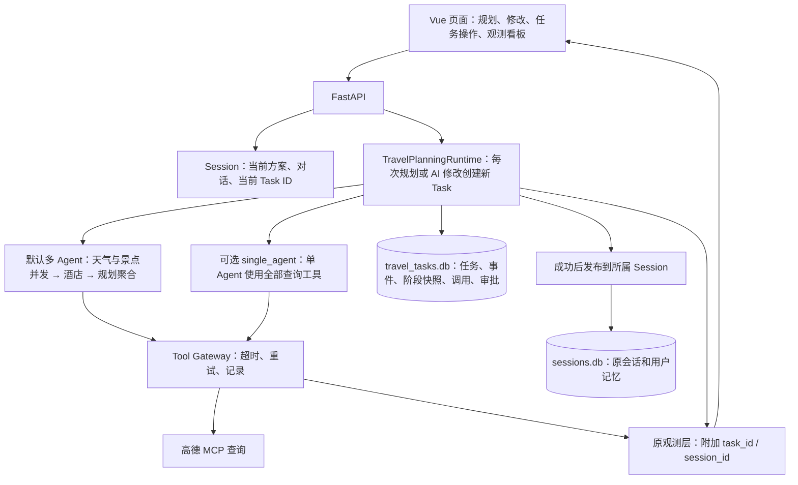

# MCP 原项目整合说明

整合目标是 `D:\AIproject\MCP`。以本地原有代码为底，接入 repo-audit 的旅行 Runtime、工具网关及审批能力，保留观测看板、用户记忆、会话、地图和原启动方式。

## 一个请求如何运行



天气与景点查询并发；酒店依赖景点坐标；最终规划 Agent 只聚合结果。工具仍由 MCP 启动时发现，按专家关键字筛选，然后注册到 Gateway。当前不是服务运行中自动热发现。

## 保留和新增

| 能力 | 行为 |
|---|---|
| 原观测层 | 保留 HTTP、LLM、Agent、工具、安全指标与页面；运行中的事件附加 Task/Session 标识，原事件表新增 Task 列 |
| 用户偏好 | 保留原用户记忆库；创建任务时冻结本次偏好上下文，传给专家和最终规划 |
| Session | 保存当前方案和对话；原表新增 `current_task_id`，旧数据可读取 |
| Task | 初次规划、每次 AI 修改各有独立 ID；失败修改不改变 Session 当前方案；旧任务结果保留 |
| 修改校验 | 复用原 Harness 输入/输出校验、超时、会话频率限制和安全事件；结构化坐标不作为文本脱敏 |
| 失败处理 | 取消修改 Harness 内部递归重试和成功式降级；失败进入 Task 状态，由用户恢复。查询工具重试仍由 Gateway 负责 |
| 工具调用 | 查询超时 15 秒，最多重试 2 次；每次调用落库。未知工具在 Agent 循环中回填错误 Observation；达到轮数上限则任务失败 |
| 恢复 | 复用已完成的天气、景点、酒店和计划阶段；未完成阶段重新运行，不保证从某条 LLM 消息精确恢复 |
| 模拟预订 | 用户主动选择单晚酒店才生成提案；审批绑定参数摘要；相同成功调用复用结果，未知写入结果禁止自动重放 |
| Token 统计 | 按 Task 累计模型实际返回 usage，避免并发任务共享全局差值；不等于服务商最终账单 |
| 地图 | 使用原前端高德 JS Key 与安全码；初始化失败显示原因。后端 MCP Key 不能替代前端 JS Key |

Session 的当前方案会在修改成功后更新，但旧 Task 的计划快照不会被覆盖。发布时检查父 Task，避免较早的并发修改覆盖新方案。原手动编辑仍属于前端编辑行为，没有新增服务端版本保存接口；模拟预订始终基于 Task 保存的方案，提交前核对提案里的酒店和日期。

## 启动：继续用原环境和配置

先停止原后端，再从原目录重启。不要同时在几个项目目录启动同端口的服务。

后端 PowerShell：

```powershell
conda activate hello-agent
cd D:\AIproject\MCP\app
uvicorn api:app --host 0.0.0.0 --port 8000 --workers 1
```

另一个终端启动前端：

```powershell
cd D:\AIproject\MCP\frontend
npm run dev
```

打开 `http://localhost:5173/`。原 `app/.env` 和 `frontend/.env` 继续使用，不需要重新填写密钥。整合没有替换这些配置，也没有安装另一套 Python 环境。依赖已存在时不必重复安装；依赖清单只补齐代码本来已经使用的包。

默认 `PLANNING_MODE=multi_agent`。如需比较单 Agent 模式，在启动后端前设置：

```powershell
$env:PLANNING_MODE = "single_agent"
uvicorn api:app --host 0.0.0.0 --port 8000 --workers 1
```

恢复默认：将变量改为 `multi_agent` 后重启后端。失败任务需在创建它时的模式下恢复。

## 本地验收

离线回归（假模型、假 MCP、临时 SQLite，不消耗真实 API 额度）：

```powershell
cd D:\AIproject\MCP
& "$env:USERPROFILE\.conda\envs\hello-agent\python.exe" -B -X utf8 -m unittest tests.test_travel_runtime tests.test_runtime_observability -q
cd frontend
.\node_modules\.bin\vue-tsc.cmd --noEmit
npm run build
```

真实端到端验收需要启动上述服务和有效密钥，并实际产生模型/地图请求：

1. 规划一个城市的一至两日行程，检查预算、地图、酒店和天气；普通规划应直接完成，无审批。
2. 在观测看板查看 Agent 执行、Token 和带 Task ID 的事件；天气/景点专家应并发，酒店随后执行。
3. 智能修改一次，检查 Session ID 不变、Task ID 改变；刷新页面应恢复当前方案。
4. 查看 `GET /api/travel/tasks/{task_id}`，核对事件、checkpoint 和工具调用；旧 Task 仍可查询。
5. 任务失败时点击“从已保存阶段继续”；已完成阶段不重跑，修改失败时旧方案仍可使用。
6. 在可选操作中生成模拟单晚预订，分别验证拒绝和批准；只有批准才执行模拟工具。

关键源码：`app/runtime/travel_runtime.py`、`app/runtime/revision_harness.py`、`app/mcp_gateway/`、`app/services/task_session_service.py`、`app/observability/execution_context.py`。

## 工程边界

- 当前是本地单进程演示，必须 `--workers 1`；内存锁和 Harness 会话限流不是分布式控制，进程重启会清空。
- Stage Checkpoint 和工具事件持久化；原看板聚合指标仍是进程内数据，重启后不从任务库重建全部历史指标。
- SQLite 各步骤分别提交，不宣称跨表、跨外部服务的 exactly-once；写入结果不明确时需要人工核对。
- 模拟预订不会创建真实订单、扣款或发邮件。`required_scope` 为元数据，没有新增登录、角色权限或真实订单服务。
- 任务隔离防止历史消息串线，但恢复未完成阶段仍可能再次执行只读查询和模型推理。
- 离线测试和前端构建不能替代真实模型、地图鉴权和页面渲染验收；不据此声称延迟或 Token 已降低某个百分比。
